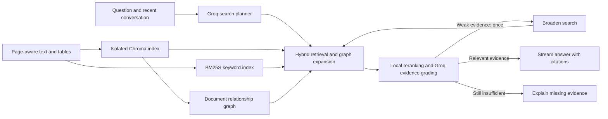

# Folio — document comparison workspace

Compare PDF and DOCX content, tables, images, structure, and metadata. Read changes side by side and ask questions with inspectable source references.

## Run locally

Python **3.11 or newer** is required. The verified environment uses Python 3.11 on Windows.

```powershell
py -3.11 -m venv .venv
.\.venv\Scripts\python.exe -m pip install -r requirements.txt
Copy-Item .env.example .env
.\.venv\Scripts\python.exe -m streamlit run src/streamlit_app.py
```

After setup, `./run.ps1` launches the app on [localhost:8501](http://localhost:8501).

Comparison works without cloud API keys. For answers, set `GROQ_API_KEY` in `.env`; optionally set `GROQ_MODEL`. Never commit `.env`. The first analysis downloads local models into the project's ignored `.cache` directory. A reranker downloads on the first evidence check. Restart after changing environment settings.

## Hugging Face Docker deployment

Keep the YAML header at the very start of this README. `sdk: docker` selects the
Dockerfile, and `app_port: 8501` matches the Streamlit port in the Docker entry
point. Docker Spaces do not need a Gradio `sdk_version` or `app_file` setting.

The Docker entry point also configures the public HTTPS host and explicitly
allows the Space and Hugging Face origins. XSRF protection stays enabled;
`server.xsrfCookieSameSite=none` makes Streamlit send a `SameSite=None; Secure`
cookie so PDF/DOCX uploads work in the cross-site Hugging Face iframe. This
HTTPS-specific override is only in Docker; local HTTP runs keep the default
SameSite policy. See the [Streamlit cookie configuration](https://docs.streamlit.io/develop/api-reference/configuration/config.toml).

The existing GitHub Actions workflow mirrors pushes to `main` to
`syedmohaiminulhoque/agentic-doc-sim-streamlit`. A local commit must be pushed to
GitHub to trigger it. The workflow uses the GitHub repository's `HF_TOKEN` secret.
Configure `GROQ_API_KEY` separately in the Hugging Face Space's Settings → Secrets;
the local `.env` is intentionally not committed or copied into the image.

The container runs as UID 1000 and owns its application, upload, and cache paths.
Run `python -m unittest discover -s tests -p test_space_configuration.py -v` to
check the README metadata against the Docker entry point before deploying.

## Workspace

- **Compare documents:** upload two files or try the sample pair; choose balanced, content-first, or custom weights.
- **Overview:** normalized similarity, extracted-line changes, modality availability, matching passages, and a downloadable JSON report.
- **Documents & changes:** PDF page previews, Word text, extracted tables/images, a side-by-side text diff, and HTML export.
- **Ask documents:** prepare a local index, ask questions, inspect cited passages and retrieval steps, and clear conversation history.
- **Batch review:** compare one reference against up to ten candidates; rank results and export CSV.
- **Architecture:** inspect the actual workflow and the dated tooling audit.

## Retrieval architecture



LangGraph controls planning, retrieval, grading, and the bounded retry. A local reranker orders passages; Groq checks evidence relevance separately because ranking scores are not calibrated confidence values. If the provider check is unavailable, a local evidence check is used. The document graph connects adjacent, semantically similar, and shared-term passages. It does **not** perform LLM entity/relation extraction or claim to implement Microsoft's GraphRAG.

Text and CLIP model instances are shared across analyses. Each comparison index has its own collection; replacing a comparison removes that collection. Conversation history and answer context have size limits. Failed generations do not commit chat history.

Similarity averages best matches in both directions. Jointly absent content is excluded from effective weights; content found only on one side is a difference. Metadata uses a normalized weighted average. Scores are similarity measures, not calibrated factual-confidence probabilities.

## Verification

```powershell
.\.venv\Scripts\python.exe -m unittest discover -s tests -v
.\.venv\Scripts\python.exe tests/integration_check.py
# Uses your Groq key and makes live requests:
.\.venv\Scripts\python.exe tests/integration_check.py --live-chat
```

Browser verification uses `requirements-dev.txt` and Playwright; see [the validation report](docs/VALIDATION.md). Integration artifacts are written under `.cache/validation`.

[The October 2026 tooling audit](docs/TOOLING_AUDIT_2026.md) compares the selected stack with Docling, LangGraph, LightRAG, Microsoft GraphRAG, LlamaIndex, and the current upstream libraries. Direct runtime versions are pinned in `requirements.txt`; `requirements.lock.txt` snapshots the complete verified environment, including development tooling.

## Limits

- PDF/DOCX only; maximum 50 MB per upload. Scanned PDFs need a searchable OCR text layer.
- Word physical pagination is not inferred. Word citations refer to logical sections.
- Layout comparison is heuristic; CLIP is semantic image similarity, not pixel-level or chart-value verification.
- The text diff viewer is limited to the first 5,000 lines. Previews show up to 30,000 extracted characters.
- Local indexes are in memory and are rebuilt after restarting. Uploaded files stay in the ignored local data directory.
- Comparison runs locally. For chat, the question and selected evidence are sent to Groq.
- This is a local workspace, without accounts, durable multi-user storage, or an authentication layer. Public deployment needs a separate deployment review.

## Structure

```text
src/streamlit_app.py           Workspace UI
src/services/comparison.py    UI-independent comparison workflow
src/agents/                   Modality extraction
src/orchestrator/             Similarity aggregation and scoring
src/rag/                      LangGraph workflow, hybrid search, graph, and chat
src/utils/                    File handling, shared models, and text diffs
tests/                        Regression tests and live integration checks
docs/                         Tooling audit and validation record
```
